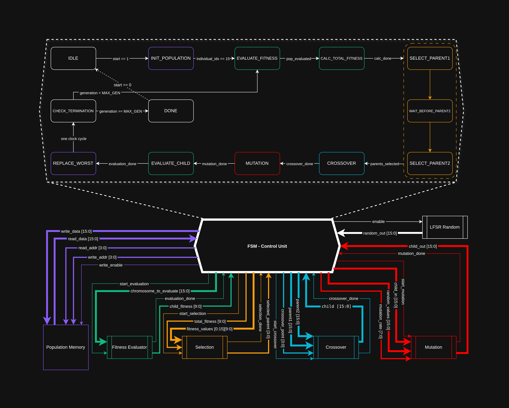

# GA-Accelerator-SV
> SystemVerilog Genetic Algorithm Accelerator — RTL Debugging & FPGA Synthesis Optimization

## 1. Project Overview

This repository features the hardware implementation, RTL refactoring, and architectural debugging of a **SystemVerilog-based Genetic Algorithm (GA) Accelerator** targeting Xilinx 7-series FPGAs (Virtex-7).

While genetic algorithms provide robust heuristic search capabilities, pure software implementations suffer from execution bottlenecks in evaluation and selection stages. Implementing GA on hardware eliminates these bottlenecks but exposes critical RTL challenges: multi-cycle Block RAM read latencies, dynamic part-select constraints during crossover, pseudo-random sequence scaling, and FSM synchronization deadlocks.

### Key Contributions & Engineering Scope

This project focuses on **production-grade RTL debugging, hardware-aware synthesis optimizations, and timing synchronization**:

- **BRAM Latency & FSM Synchronization:** Resolved critical multi-cycle memory read latencies by decoupling register evaluation and inserting deterministic synchronization wait-states in the central controller.
- **Hardware-Aware Synthesis Mapping:** Enforced dedicated Block RAM inference (`ram_style = "block"`) for population storage to eliminate distributed LUT bloat, and mapped arithmetic-heavy roulette scaling to dedicated DSP48 slices (`use_dsp`).
- **Bit-Accurate Arithmetic & Logic Fixes:** Corrected combinational adder-tree accumulation bugs (blocking vs. non-blocking assignments in for-loops) and resolved bit-width mismatch between PRNG output and mutation probability logic.
- **Parameterization:** Upgraded the pipeline to fully parameterized widths (configurable 16-bit LFSR PRNG, dynamic crossover masks, and population scaling).
- **Integration & Smoke-Test Verification:** Validated the refactored architecture with an end-to-end directed smoke test, ensuring zero FSM lockups across full multi-generation runs.

> **Note:** Originally developed as the capstone project for the *FPGA-Based System Design* course under the supervision of **Dr. Ali Mahani** at Shahid Bahonar University of Kerman, this repository takes a baseline architectural template and transforms it into a fully synchronized, synthesis-optimized, and verified RTL implementation.

---

## 2. Repository Structure

```
ga-hardware-accelerator/
├── fpga/
│   ├── vivado/                 # Tcl scripts for Vivado project creation and synthesis
│   │   └── Ga_Prj.tcl
│   └── build/                  # gitignored — all Vivado-generated outputs land here
│       └── Ga_Prj/
├── rtl/                        # Synthesizable RTL sources (no testbenches)
│   ├── crossover.sv
│   ├── fitness_evaluator.sv
│   ├── genetic_algorithm.sv    # Top-level FSM controller
│   ├── lfsr_random.sv
│   ├── mutation.sv
│   ├── population_memory.sv
│   └── selection.sv
├── scripts/
│   └── block-diagram/
│       └── GA-Diagram.drawio   # Editable architecture block diagram
├── tb/
│   └── sv/                     # SystemVerilog testbenches
│       └── tb_genetic_algorithm_smoke.sv
├── Makefile                    # Simulation targets (see Quick Start)
├── README.md
├── LICENSE
└── .gitignore
```
---

## 3. Architecture Overview

The diagram below shows the full architecture — the upper panel is the 13-state FSM, and the lower panel shows the signal-level interconnect between the FSM Control Unit and each datapath submodule.

<picture>
  <source media="(prefers-color-scheme: dark)"
          srcset="scripts/block-diagram/BlockDiagramDark.png">
  <source media="(prefers-color-scheme: light)"
          srcset="scripts/block-diagram/BlockDiagramLight.png">
  
</picture>

> Editable source: [`scripts/block-diagram/GA-Diagram.drawio`](scripts/block-diagram/GA-Diagram.drawio)

---

### 3.1 Signal Color Legend

Each wire bundle in the diagram is color-coded by the submodule it drives or returns from. The same grouping is used in all signal tables and state descriptions below.

| Color | Submodule | Direction |
|---|---|---|
| 🟣 Purple | Population Memory | Bidirectional (FSM drives address/data/enable; BRAM returns `read_data`) |
| 🟢 Green | Fitness Evaluator | FSM drives `start` + chromosome; module returns `done` + fitness score |
| 🟠 Orange | Selection | FSM drives `start` + fitness arrays; module returns `done` + parent index |
| 🔵 Cyan | Crossover | FSM drives `start` + both parents + crossover point; module returns `done` + child |
| 🔴 Red | Mutation | FSM drives `start` + child + random values + rate; module returns `done` + mutated child |
| ⬜ White | LFSR Random | FSM asserts `enable`; LFSR continuously outputs `random_out[15:0]` |

---

### 3.2 Module Interconnect Summary

| Module | FSM → Module | Module → FSM |
|---|---|---|
| 🟣 **Population Memory** | `write_data[15:0]`, `write_addr[3:0]`, `read_addr[3:0]`, `write_enable` | `read_data[15:0]` |
| 🟢 **Fitness Evaluator** | `start_evaluation`, `chromosome_to_evaluate[15:0]` | `evaluation_done`, `child_fitness[9:0]` |
| 🟠 **Selection** | `start_selection`, `total_fitness[9:0]`, `fitness_values[0:15][9:0]` | `selection_done`, `selected_parent[3:0]` |
| 🔵 **Crossover** | `start_crossover`, `parent1[15:0]`, `parent2[15:0]`, `crossover_point[3:0]` | `crossover_done`, `child[15:0]` |
| 🔴 **Mutation** | `start_mutation`, `child_in[15:0]`, `random_values[15:0]`, `mutation_rate[7:0]` | `mutation_done`, `child_out[15:0]` |
| ⬜ **LFSR Random** | `enable` | `random_out[15:0]` |

All five datapath modules are stateless workers. They execute a single operation when the FSM pulses their `start_*` input and signal completion back via a `*_done` handshake. The LFSR runs freely whenever `enable` is asserted, continuously supplying fresh random bits without any request/acknowledge overhead.

---

### 3.3 FSM State Machine

The controller is a **13-state Moore FSM** in `genetic_algorithm.sv`. States are grouped into three logical phases.

#### Phase 1 — Initialization

```
IDLE ──(start == 1)──► INIT_POPULATION ──(individual_idx == 15)──► EVALUATE_FITNESS
  ▲
  └──(start == 0, from INIT_POPULATION)
```

- **`IDLE`** — Reset anchor. All submodule enables are deasserted. The FSM waits here until `start` is asserted.

- **`INIT_POPULATION`** — Writes the seed population into 🟣 Population Memory. Each cycle, the FSM increments `individual_idx` and asserts `write_enable` with the corresponding initial chromosome on `write_data[15:0]` and `write_addr[3:0]`. Exits when `individual_idx == 15` (all 16 chromosomes written). If `start` is deasserted mid-run, returns to `IDLE`.

#### Phase 2 — Population Fitness Evaluation

```
EVALUATE_FITNESS ──(pop_evaluated)──► CALC_TOTAL_FITNESS ──(calc_done)──► SELECT_PARENT1
       ▲
       │  (per-individual loop, internal counter)
       └──────────────────────────────────────────
```

- **`EVALUATE_FITNESS`** — Iterates over all 16 individuals. Per iteration: the FSM drives `read_addr[3:0]` on 🟣 Population Memory, waits one cycle for synchronous BRAM read latency (this wait-state is the targeted fix for stale-data reads), then pulses 🟢 `start_evaluation` with the stable `chromosome_to_evaluate[15:0]`. The returned `child_fitness[9:0]` is latched into a local `fitness_values` array. Advances when all 16 entries are collected (`pop_evaluated`).

- **`CALC_TOTAL_FITNESS`** — Accumulates the full `fitness_values[0:15]` array into a `total_fitness[9:0]` sum for use in roulette-wheel selection. The adder-tree runs in a single registered pipeline stage mapped to a DSP48 slice. Raises `calc_done` when the sum is stable.

#### Phase 3 — Evolutionary Loop (per generation)

The right-hand dashed box in the diagram marks the parent-selection cluster (🟠 orange borders). The 🔴 MUTATION state carries a red border in the diagram indicating it was a targeted RTL fix site.

```
SELECT_PARENT1
      │
      ▼
WAIT_BEFORE_PARENT2        ← one-cycle BRAM latency bubble
      │
      ▼
SELECT_PARENT2 ──(parents_selected)──► CROSSOVER ──(crossover_done)──► MUTATION
                                                                              │
                                                              (mutation_done) ▼
REPLACE_WORST ◄──(evaluation_done)── EVALUATE_CHILD ◄────────────────────────
      │
      │  (one clock cycle)
      ▼
CHECK_TERMINATION ──(generation >= MAX_GEN)──► DONE
      │
      └──(generation < MAX_GEN)──► SELECT_PARENT1
```

- **`SELECT_PARENT1`** — Asserts 🟠 `start_selection`, passes `total_fitness` and `fitness_values` to the Selection module. The roulette-wheel selector draws a random number from the running ⬜ LFSR and returns `selected_parent[3:0]`. The FSM then issues the first `read_addr` to 🟣 Population Memory.

- **`WAIT_BEFORE_PARENT2`** — A deliberate single-cycle bubble. Its sole function is to absorb the synchronous BRAM read latency after requesting parent 1's chromosome, so `read_data[15:0]` is stable before being latched. This state was introduced as the targeted fix for FSM deadlocks caused by sampling BRAM output on the same cycle as address assertion.

- **`SELECT_PARENT2`** — Runs a second independent roulette-wheel call for the second parent. Once both chromosomes are fetched, `parents_selected` is raised internally and the FSM passes `parent1[15:0]` and `parent2[15:0]` to 🔵 Crossover.

- **`CROSSOVER`** — Asserts 🔵 `start_crossover` with both parent chromosomes and a `crossover_point[3:0]` sampled from the ⬜ LFSR. The Crossover module performs a single-point cut and returns `child[15:0]` with `crossover_done`.

- **`MUTATION`** — Asserts 🔴 `start_mutation` with the child chromosome, a fresh `random_values[15:0]` word from the ⬜ LFSR, and the configured `mutation_rate[7:0]`. Each chromosome bit is probabilistically flipped. The bit-width alignment between the 16-bit LFSR output and the mutation probability comparator is a targeted fix in this implementation. Returns `child_out[15:0]` and `mutation_done`.

- **`EVALUATE_CHILD`** — Re-uses the 🟢 Fitness Evaluator handshake to score the mutated child. The result `child_fitness[9:0]` is held for the replacement decision.

- **`REPLACE_WORST`** — Scans the local `fitness_values` array for the weakest individual and writes the child chromosome into 🟣 Population Memory at that index via `write_addr[3:0]` and `write_enable`. Completes in one clock cycle.

- **`CHECK_TERMINATION`** — Increments `generation` counter. If `generation < MAX_GEN`, loops back to `SELECT_PARENT1`. If `generation >= MAX_GEN`, falls through to `DONE`.

- **`DONE`** — Terminal state. Asserts the top-level `done` output. The FSM holds here until reset.

---

## 4. Quick Start

### Prerequisites

| Tool | Version | Notes |
|------|---------|-------|
| Vivado Design Suite | 2024.2 | Includes xvlog / xelab / xsim |
| GNU Make | ≥ 3.82 | Available in Vivado install shell |
| Target device | `xc7vx485tffg1157-1` | Virtex-7 — required only for `make project` |

Add Vivado's `bin/` directory to `$PATH` before running any target:
```bash
source /tools/Xilinx/Vivado/2024.2/settings64.sh   # adjust path as needed
```

---

### Repository layout (quick reference)

```
ga-hardware-accelerator/
├── rtl/                  # Synthesizable RTL (7 modules)
├── tb/sv/                # SystemVerilog testbenches
├── fpga/
│   ├── vivado/           # Tcl project scripts
│   └── build/            # Generated artifacts (git-ignored)
└── Makefile
```

---

### 1 — Generate the Vivado project

```bash
make project
```

Runs `fpga/vivado/Ga_Prj.tcl` in batch mode to create a Vivado project under `fpga/build/`. Open it afterward with:

```bash
vivado fpga/build/vivado_prj_*/GA_Prj.xpr
```

From there, run Synthesis → Implementation → Bitstream generation against `xc7vx485tffg1157-1`.

---

### 2 — Run the smoke simulation

```bash
make sim        # same as: make all
```

This executes three steps inside `fpga/build/`:

| Step | Command | Purpose |
|------|---------|---------|
| Compile | `xvlog -sv rtl/*.sv tb/sv/tb_genetic_algorithm_smoke.sv` | Parse all RTL + testbench |
| Elaborate | `xelab tb_genetic_algorithm_smoke -s top_sim` | Build simulation snapshot |
| Simulate | `xsim top_sim -R` | Run to completion |

A passing run ends without `$fatal` assertions. Build artifacts land in `fpga/build/` and are git-ignored.

---

### 3 — Clean build artifacts

```bash
make clean
```

Removes everything under `fpga/build/` along with any stray `.log` and `.jou` files in the project root.

---

### Makefile target summary

| Target | Alias | Description |
|--------|-------|-------------|
| `make sim` | `make all` | Compile, elaborate, and simulate smoke testbench |
| `make project` | — | Generate Vivado project via Tcl batch script |
| `make clean` | — | Delete all build outputs |

---

## 5. RTL Modules

Each module is fully parameterized and synthesized for Xilinx Virtex-7 (`xc7vx485tffg1157-1`) under Vivado 2024.2.

---

### 5.1 `genetic_algorithm.sv` — Top-Level Controller

| Parameter | Default | Description |
|---|---|---|
| `CHROMOSOME_WIDTH` | 16 | Bits per chromosome |
| `POPULATION_SIZE` | 16 | Number of individuals |
| `MAX_GENERATIONS` | 100 | Termination threshold |
| `FITNESS_WIDTH` | 10 | Fitness value bit-width |
| `MUTATION_RATE` | `8'h10` | Mutation probability threshold |
| `ADDR_WIDTH` | `$clog2(POPULATION_SIZE)` | Auto-derived address width |

**Ports:** `clk`, `rst_n`, `start_ga`, `initial_population[15:0]` → `best_chromosome[15:0]`, `best_fitness[9:0]`, `ga_done`

**FSM — 13-state, 4-bit enum:**

```
IDLE → INIT_POPULATION → EVALUATE_FITNESS → CALC_TOTAL_FITNESS
     → SELECT_PARENT1 → WAIT_BEFORE_PARENT2 → SELECT_PARENT2
     → CROSSOVER → MUTATION → EVALUATE_CHILD → REPLACE_WORST
     → CHECK_TERMINATION → DONE
```

`CHECK_TERMINATION` loops back to `EVALUATE_FITNESS` if `generation_count < MAX_GENERATIONS`, otherwise advances to `DONE`. `DONE` returns to `IDLE` on `start_ga` deassert.

Instantiates one of each submodule: `lfsr_inst`, `pop_mem`, `fitness_inst`, `selection_inst`, `crossover_inst`, `mutation_inst`. Fitness function: popcount (maximize set bits).

---

### 5.2 `population_memory.sv` — Individual Storage

| Parameter | Default |
|---|---|
| `CHROMOSOME_WIDTH` | 8 |
| `POPULATION_SIZE` | 16 |
| `ADDR_WIDTH` | `$clog2(POPULATION_SIZE)` |

Synchronous write (`write_enable`-gated), asynchronous read. The synthesis attribute below forces BRAM inference instead of distributed/LUT RAM:

```systemverilog
(* ram_style = "block" *) logic [CHROMOSOME_WIDTH-1:0] population [POPULATION_SIZE];
```

No FSM. Single-cycle read latency.

---

### 5.3 `fitness_evaluator.sv` — Fitness Computation

| Parameter | Default |
|---|---|
| `CHROMOSOME_WIDTH` | 8 |
| `FITNESS_WIDTH` | 10 |

Evaluates popcount of `chromosome` when `start_evaluation` is asserted and `evaluation_done` is clear. Uses a blocking-assignment accumulation chain in `always_comb` (`fitness_next`) registered via `always_ff`. The `!evaluation_done` guard prevents re-evaluation on held inputs — this was the accumulation bug fixed in Rev 1.00.

No FSM; single-cycle combinational path with registered output.

---

### 5.4 `lfsr_random.sv` — Pseudo-Random Number Generator

| Parameter | Default |
|---|---|
| `WIDTH` | 16 |
| `SEED` | `{WIDTH{1'b1}}` |

Right-shift Galois LFSR with XOR feedback on taps 15, 13, 12, 10 — implements the maximal-length polynomial $x^{16}+x^{14}+x^{13}+x^{11}+1$. Non-zero seed guarantees the LFSR never locks up. Advances one step per cycle when `enable` is high; `random_out` maps directly to the shift register.

---

### 5.5 `crossover.sv` — Single-Point Crossover

| Parameter | Default |
|---|---|
| `CHROMOSOME_WIDTH` | 8 |

Accepts `parent1`, `parent2`, and a `crossover_point[$clog2(CHROMOSOME_WIDTH)-1:0]` from the LFSR. The point is clamped to `[1, CHROMOSOME_WIDTH-1]` to prevent degenerate all-one or all-zero masks.

To overcome Verilog's non-constant part-select limitation (`child <= {p1[W-1:cp], p2[cp-1:0]}` is illegal in synthesizable RTL), the module implements dynamic bitwise masking via a combinational barrel shifter:

```systemverilog
logic [CHROMOSOME_WIDTH-1:0] mask, mixed;

always_comb begin
// Dynamic bitmask generation via variable shift
mask  = {CHROMOSOME_WIDTH{1'b1}} >> (CHROMOSOME_WIDTH - cp);
mixed = (parent1 & ~mask) | (parent2 & mask);
end
```

The resulting chromosome is synchronously registered into `child` on `start_crossover` with `crossover_done` asserted.

---

### 5.6 `mutation.sv` — Bit-Flip Mutation

| Parameter | Default |
|---|---|
| `CHROMOSOME_WIDTH` | 16 |

Takes `child_in`, per-gene random bits `random_values[15:0]`, and `mutation_rate[7:0]` (0–255 threshold). For each bit position $i$:

$$\text{flip bit}_i \iff \{8\{random\_values[i]\}\} < mutation\_rate$$

The expansion `{8{random_values[i]}}` converts a single random bit into a comparable 8-bit value, making rate control linear over the full byte range. Registered on `start_mutation`.

---

### 5.7 `selection.sv` — Roulette-Wheel Selection

| Parameter | Default |
|---|---|
| `CHROMOSOME_WIDTH` | 16 |
| `POPULATION_SIZE` | 16 |
| `FITNESS_WIDTH` | 10 |

Internally instantiates `lfsr_random` (`WIDTH=CHROMOSOME_WIDTH`). Implements fitness-proportionate selection with a 3-state FSM:

```
IDLE → SPINNING → DONE → IDLE
```

In `SPINNING`, `fitness_sum` accumulates across indices. Selection fires when:

$$fitness\_sum + fitness\_values[current\_idx] \geq roulette\_position$$

The roulette position is scaled from the LFSR output:

$$scaled = random\_value \times total\_fitness \qquad \text{(DSP48)}$$
$$roulette\_position = scaled \gg CHROMOSOME\_WIDTH$$

Synthesis attribute & zero-cost slicing:
```systemverilog
(* use_dsp = "yes" *) 
logic [CHROMOSOME_WIDTH + FITNESS_WIDTH - 1:0] scaled; // Maps multiplier to DSP48E1
logic [FITNESS_WIDTH-1:0] roulette_position;           // Zero-cost static wire slice
```
The dynamic multiplier is mapped directly to a dedicated DSP48E1 slice to save LUTs, while the subsequent division by $2^{W}$ (`scaled >> CHROMOSOME_WIDTH`) is implemented as zero-cost static wire slicing.

---

### Synthesis Attribute Summary

| Module | Attribute | Target Resource | Purpose |
|---|---|---|---|
| `population_memory` | `ram_style = "block"` | RAMB18 / BRAM36 | Enforces dedicated Block RAM inference, preventing distributed LUT-RAM bloat. |
| `selection` | `use_dsp = "yes"` on `scaled` | DSP48E1 | Directs the arithmetic scaling multiplication into dedicated DSP hardware slices. |

---

## 6. Parameters Reference

All synthesizable parameters are declared in module headers; no `localparam` is used anywhere in the design. The top-level `genetic_algorithm.sv` drives six parameters that propagate to every sub-module via explicit port-map overrides.

### 6.1 Top-Level Parameters (`genetic_algorithm.sv`, lines 40–45)

| Parameter | Type | Default | Range / Notes |
|---|---|---|---|
| `CHROMOSOME_WIDTH` | `int` | `16` | Bit-width of each chromosome; must be a power of two for clean DSP mapping |
| `POPULATION_SIZE` | `int` | `16` | Number of individuals; sets BRAM depth and selection loop bounds |
| `MAX_GENERATIONS` | `int` | `100` | Evolution budget; the FSM halts when the generation counter reaches this value |
| `MUTATION_RATE` | `logic [7:0]` | `8'h10` | Fractional threshold over 256 (≈ 6.25 %); compared against an 8-bit LFSR sample |
| `FITNESS_WIDTH` | `int` | `10` | Accumulator width for fitness scores; must be wide enough to hold the population-level sum used in tournament selection |
| `ADDR_WIDTH` | `int` | `$clog2(POPULATION_SIZE)` | Derived automatically; sets BRAM address bus and loop-counter widths |

> `ADDR_WIDTH` is re-derived independently in `population_memory.sv` and `selection.sv` using the same `$clog2` expression, so it stays consistent even when `POPULATION_SIZE` is overridden.

---

### 6.2 LFSR-Specific Parameters (`lfsr_random.sv`, lines 35–36)

| Parameter | Default | Notes |
|---|---|---|
| `WIDTH` | `16` | Shift-register length; controls randomness period ($2^{WIDTH} - 1$ cycles) |
| `SEED` | `{WIDTH{1'b1}}` | All-ones by default; replication operator guarantees a non-zero seed for any `WIDTH`, fixing the hard-coded seed bug from Rev 1.00 |

---

### 6.3 Sub-Module Defaults vs. Top-Level Override

Sub-modules carry their own conservative defaults (mostly 8-bit) for standalone simulation, but every instance in the top-level is overridden explicitly:

| Sub-module | Standalone `CHROMOSOME_WIDTH` default | Overridden at top-level? |
|---|---|---|
| `population_memory.sv` | `8` | Yes — `CHROMOSOME_WIDTH(CHROMOSOME_WIDTH)` |
| `fitness_evaluator.sv` | `8` | Yes |
| `crossover.sv` | `8` | Yes |
| `selection.sv` | `16` | Yes |
| `mutation.sv` | `16` | Yes |
| `lfsr_random.sv` | `16` (`WIDTH`) | Yes — mapped to `CHROMOSOME_WIDTH` |

This split lets each module be instantiated and testbenched independently at a narrow width while the full system runs at the width configured in the top-level.

---

### 6.4 Typical Configuration Examples

```systemverilog
// Default 16-bit, 16-individual run
genetic_algorithm #(
    .CHROMOSOME_WIDTH (16),
    .POPULATION_SIZE  (16),
    .MAX_GENERATIONS  (100),
    .MUTATION_RATE    (8'h10),   // ~6.25 %
    .FITNESS_WIDTH    (10)
) u_ga ( ... );

// Wider chromosome, larger population
genetic_algorithm #(
    .CHROMOSOME_WIDTH (32),
    .POPULATION_SIZE  (64),
    .MAX_GENERATIONS  (200),
    .MUTATION_RATE    (8'h1A),   // ~10 %
    .FITNESS_WIDTH    (14)       // must hold sum across 64 individuals
) u_ga ( ... );
```

> **Sizing rule for `FITNESS_WIDTH`:** to avoid accumulator overflow during tournament selection, set $\text{FITNESS\_WIDTH} \geq \lceil \log_2(\text{POPULATION\_SIZE} \times \text{max\_individual\_fitness}) \rceil$.

---

## 7. Testing & Verification

The repository currently ships a single top-level directed smoke test:

**`tb/sv/tb_genetic_algorithm_smoke.sv`**

| Property | Value |
|----------|-------|
| Clock | 100 MHz |
| `MAX_GENERATIONS` override | 20 (vs. 100 default) |
| Population load | 16 × `$random` chromosomes streamed via `initial_population` |
| Pass criterion | Simulation reaches `ga_done` without hanging; prints `best_chromosome` and `best_fitness` |
| Assertions | None — FSM deadlock surfaces as a simulator hang |

This test covers power-on reset sequencing, the `INIT_POPULATION` streaming protocol, and end-to-end FSM progression. It is a sanity check after RTL changes, not a correctness proof.

> For the full verification environment — self-checking logic, golden-model comparison, SVA properties, and functional coverage — see [`docs/tb_README.md`](docs/tb_README.md).


>*"The repository currently includes a top-level directed smoke test (`tb_genetic_algorithm.sv`) for integration sanity checking and FSM deadlock verification. A comprehensive, self-checking, parameter-driven verification environment is currently under development on the `verif-adv` branch."*

## Acknowledgments
Special thanks to **Dr. Ali Mahani** ([GitHub](https://github.com/alimahani)) for providing the initial baseline RTL specification and academic guidance during the *Design of digital systems (FPGA, ASIC)* course at Shahid Bahonar University of Kerman.

### License

This project is open-source and distributed under the **Apache License 2.0**. See the [LICENSE](LICENSE) file for more details.
